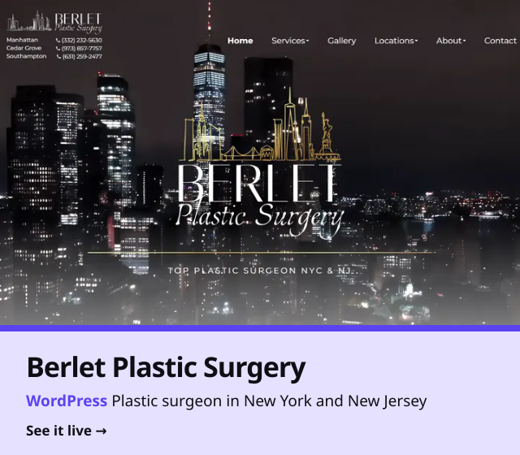
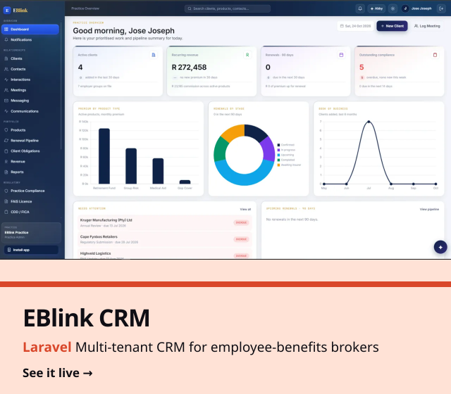
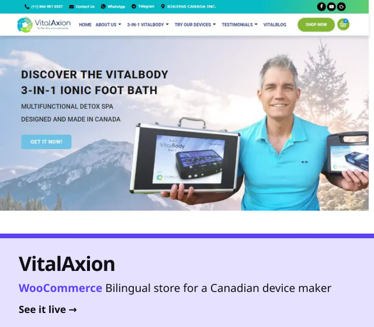
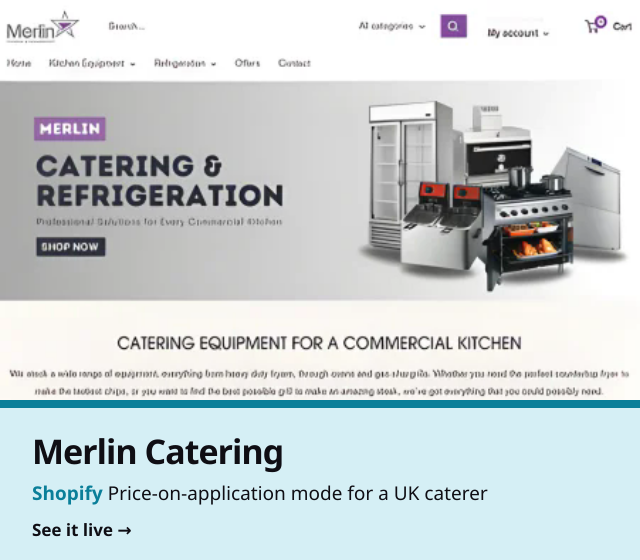
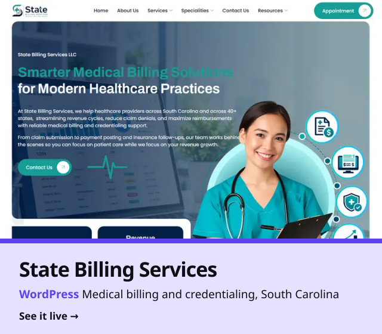
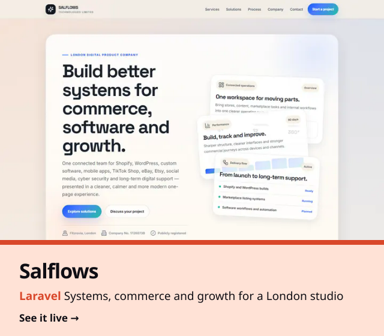

<a href="https://abdul.ecomflows.net/">
  <picture>
    <source media="(prefers-color-scheme: dark)" srcset="assets/hero-dark.svg">
    
  </picture>
</a>

  <a href="https://abdul.ecomflows.net/"><picture><source media="(prefers-color-scheme: dark)" srcset="assets/btn-portfolio-dark.svg"></picture></a>&nbsp;
  <a href="mailto:muqeet.pugc@gmail.com"><picture><source media="(prefers-color-scheme: dark)" srcset="assets/btn-email-dark.svg"></picture></a>&nbsp;
  <a href="https://www.fiverr.com/dr_webexpert"><picture><source media="(prefers-color-scheme: dark)" srcset="assets/btn-fiverr-dark.svg"></picture></a>

## What I build

<picture>
  <source media="(prefers-color-scheme: dark)" srcset="assets/stacks-dark.svg">
  
</picture>

  <picture>
    <source media="(prefers-color-scheme: dark)" srcset="https://skillicons.dev/icons?i=wordpress,php,laravel,mysql,js,react,tailwind,html,css,bootstrap,jquery,python,django,dotnet,electron,git,cloudflare&theme=dark&perline=17">
    
  </picture>

## Selected work

Real client sites, each one live. 44 builds across healthcare, eCommerce, SaaS and finance are on [the portfolio](https://abdul.ecomflows.net/).

<a href="https://abdul.ecomflows.net/go/berlet-plastic-surgery"><picture><source media="(prefers-color-scheme: dark)" srcset="assets/work-berlet-dark.svg"></picture></a>
<a href="https://abdul.ecomflows.net/go/eblink-crm"><picture><source media="(prefers-color-scheme: dark)" srcset="assets/work-eblink-dark.svg"></picture></a>
<a href="https://abdul.ecomflows.net/go/vitalaxion"><picture><source media="(prefers-color-scheme: dark)" srcset="assets/work-vitalaxion-dark.svg"></picture></a>
<a href="https://abdul.ecomflows.net/go/merlin-catering"><picture><source media="(prefers-color-scheme: dark)" srcset="assets/work-merlin-dark.svg"></picture></a>
<a href="https://abdul.ecomflows.net/go/state-billing-services"><picture><source media="(prefers-color-scheme: dark)" srcset="assets/work-state-billing-dark.svg"></picture></a>
<a href="https://abdul.ecomflows.net/go/salflows"><picture><source media="(prefers-color-scheme: dark)" srcset="assets/work-salflows-dark.svg"></picture></a>

## Tools I have built

- **eBay Product Hunter Pro**, a Chrome extension that finds high-demand, low-competition eBay products from sold history, sell-through and competitor stores, with Excel export.
- **FlipBridge**, a Chrome extension for eBay sellers.
- **Alpha Merge Downloader**, an Electron desktop app.
- **Zee Security Sentinel**, a WordPress firewall and login-protection plugin.
- **Speed Optimizer**, a Core Web Vitals toolkit for WordPress.

## Career path

**EcomFlows Limited**, Senior WordPress and Shopify Developer, 2025 to now 
**ThemeHive Technologies**, WordPress, Shopify and Laravel Developer 
**Zee IT Service**, WordPress Developer, 2024 
**Zi Softech**, Islamabad, Web Developer and Team Lead, 2022 to 2023 
**National IT Solution**, Islamabad, WordPress Developer, 2021 to 2022 
**Freelance**, Full-Stack Web Developer and Fiverr Level 2 seller, 2019 to now 
**Softarena Solution**, .NET Framework MVC Developer, 2018 to 2019

Bachelor's in Information Technology, University of the Punjab. English, Urdu and Punjabi.

<a href="mailto:muqeet.pugc@gmail.com">
  <picture>
    <source media="(prefers-color-scheme: dark)" srcset="assets/closing-dark.svg">
    
  </picture>
</a>
