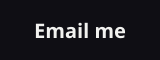

<a href="https://abdul.ecomflows.net/">
  <picture>
    <source media="(prefers-color-scheme: dark)" srcset="assets/hero-dark.svg">
    
  </picture>
</a>

  <a href="https://abdul.ecomflows.net/"><picture><source media="(prefers-color-scheme: dark)" srcset="assets/btn-portfolio-dark.svg"></picture></a>&nbsp;
  <a href="mailto:muqeet.pugc@gmail.com"><picture><source media="(prefers-color-scheme: dark)" srcset="assets/btn-email-dark.svg"></picture></a>&nbsp;
  <a href="https://www.fiverr.com/dr_webexpert"><picture><source media="(prefers-color-scheme: dark)" srcset="assets/btn-fiverr-dark.svg"></picture></a>

I'm **Abdul Muqeet**, a senior **WordPress developer**, **Shopify developer** and **Laravel developer** based in Gujranwala, Pakistan. Since 2019 I have worked remotely for clients in the US, the UK, Canada, the UAE and South Africa: custom WordPress themes and plugins, WooCommerce and Shopify stores, and Laravel CRMs and SaaS apps. Every site ships fast (Core Web Vitals), search-ready (technical SEO and schema) and hardened against attacks.

## WordPress, Shopify and Laravel development

<picture>
  <source media="(prefers-color-scheme: dark)" srcset="assets/stacks-dark.svg">
  
</picture>

## Skills and tools

<picture>
  <source media="(prefers-color-scheme: dark)" srcset="assets/skills-dark.svg">
  
</picture>

  
  
  
  
  
  
  
  
  
  
  
  
  
  
  
  
  

Also: ACF, Gutenberg, Shopify Liquid, Inertia, REST APIs, webhooks, LiteSpeed, cPanel, Plesk and MCP servers.

## Website security and hardening

<picture>
  <source media="(prefers-color-scheme: dark)" srcset="assets/security-dark.svg">
  
</picture>

Malware cleanup and hacked-site recovery, WordPress firewall and login protection, Cloudflare WAF, secure forms for healthcare clients, and backups that are restored and tested, not only taken.

## Launch checklist

<picture>
  <source media="(prefers-color-scheme: dark)" srcset="assets/checklist-dark.svg">
  
</picture>

## Tools I have built

- **eBay Product Hunter Pro**, a Chrome extension that finds high-demand, low-competition eBay products from sold history, sell-through and competitor stores, with Excel export.
- **FlipBridge**, a Chrome extension for eBay sellers.
- **[Alpha Merge Downloader](https://github.com/abdul-muqeet2k/alpha-merge-downloader)**, a free Windows download manager: up to 32 connections per file, merges Wi-Fi, Ethernet and a phone hotspot, resumes after restarts, and downloads 4K video. **[Download for Windows](https://github.com/abdul-muqeet2k/alpha-merge-downloader/releases/latest)**
- **Zee Security Sentinel**, a WordPress firewall and login-protection plugin.
- **Speed Optimizer**, a Core Web Vitals toolkit for WordPress.

## Career

<picture>
  <source media="(prefers-color-scheme: dark)" srcset="assets/timeline-dark.svg">
  
</picture>

Career in full

**ThemeHive Technologies**, WordPress, Shopify and Laravel Developer 
**EcomFlows Limited**, Senior WordPress and Shopify Developer, 2025 to now 
**Zee IT Service**, WordPress Developer, 2024 
**Zi Softech**, Islamabad, Web Developer and Team Lead, 2022 to 2023 
**National IT Solution**, Islamabad, WordPress Developer, 2021 to 2022 
**Freelance**, Full-Stack Web Developer and Fiverr Level 2 seller, 2019 to now 
**Python and Django projects**, 2019 to 2020 
**Softarena Solution**, .NET Framework MVC Developer, 2018 to 2019 
**Aptech**, web development training and internship, 2017 to 2018

Bachelor's in Information Technology, University of the Punjab. English, Urdu and Punjabi.

44 client builds across healthcare, eCommerce, SaaS and finance are on [abdul.ecomflows.net](https://abdul.ecomflows.net/).

## GitHub activity

<picture>
  <source media="(prefers-color-scheme: dark)" srcset="assets/activity-dark.svg">
  
</picture>

<a href="mailto:muqeet.pugc@gmail.com">
  <picture>
    <source media="(prefers-color-scheme: dark)" srcset="assets/closing-dark.svg">
    
  </picture>
</a>
